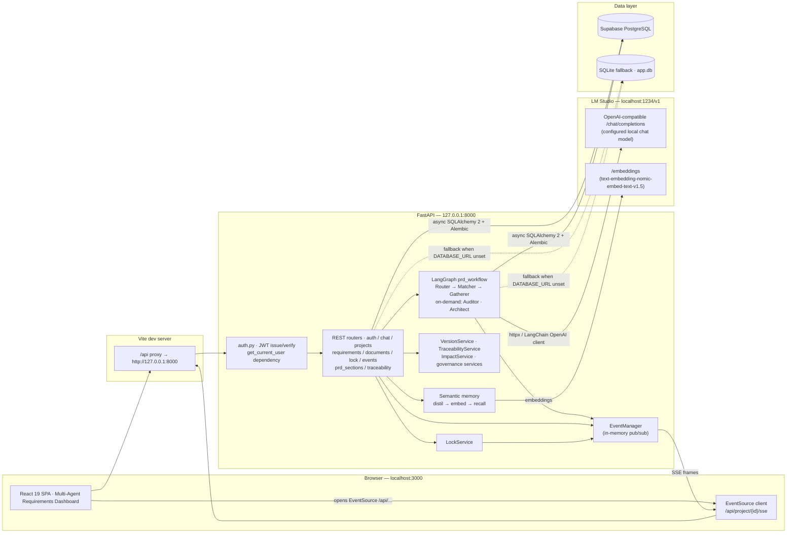
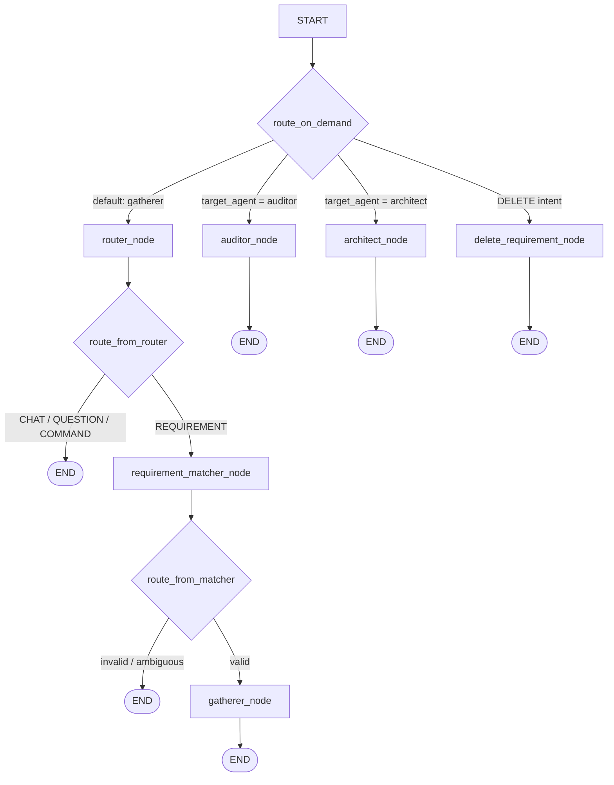

<div align="center">

# Agentic AI for PRD

### Enterprise Requirements Architecture Core

**Agentic, banking-grade requirements engineering** · local LLM (LM Studio) · FastAPI + LangGraph · Supabase PostgreSQL · React 19

Architectural policies and the invariants that refactors must preserve are
recorded in [`docs/adr`](docs/adr/README.md).

</div>

Agentic AI turns plain-English banking product briefs into **audited, versioned, engineering-ready requirements**. You sign in, describe a feature in the workspace chat — or upload an existing brief / BRD document (DOCX, PDF, Markdown, TXT) into the project's knowledge base. A LangGraph workflow of specialist agents (Router, Matcher, Gatherer, Auditor, Architect) runs against a model served locally by [LM Studio](https://lmstudio.ai). Requirement mutations are staged for confirmation, while audits and generated PRD/diagram artifacts are persisted directly. A derived **traceability matrix** reports coverage across requirements, stories, criteria, PRD sections, and diagrams.

> [!IMPORTANT]
> This project **does not** use Gemini or any cloud LLM API key. All inference happens 100% locally through LM Studio. There is **no** `.env.local` and no `GEMINI_API_KEY` setup — backend configuration lives in [`backend/.env`](backend/.env.example).

---

## Features

- **Multi-agent LangGraph workflow** — `router_node`, `requirement_matcher_node`, `gatherer_node`, `auditor_node`, `architect_node` (on-demand execution driven by a persisted workflow state machine)
- **Priority-aware requirement intake** — put `!!!`, `!!`, or `!` at the start of separate request lines to mark them Must Complete, Important, or Nice to Have; unmarked lines remain Normal, and the Gatherer preserves priority when its five-story response limit is reached
- **Local-first inference** — OpenAI-compatible calls to `http://localhost:1234/v1`; no API keys, no cloud dependency
- **Versioned banking compliance audit** — the Auditor evaluates a structured 12-rule checklist with stable rule IDs, evidence-aware applicability, actionable recommendations, and the exact checklist version persisted with every result; if a full model pass fails, it retries bounded checklist subsets and never treats unevaluated categories as passed
- **Automated PRD + system flow diagrams** — the Architect synthesizes a full Product Requirements Document and an interactive project flowchart
- **Document knowledge base & extraction** — upload DOCX / PDF / Markdown / TXT briefs (≤ `MAX_UPLOAD_MB`); they are converted to canonical markdown. General Chat retrieves only relevant, project-scoped chunks under a dedicated token budget and cites the source filename and section. Explicit, user-triggered extraction separately strips embedded image bytes from the model input, feeds the text through the Gatherer (one pass, or token-bounded overlapping chunks), and preserves explicitly headed PRD narrative such as scope, metrics, risks, and technical constraints. The result is **one staged pending action** — nothing is written until you confirm. Progress streams over SSE (`chunk X/N`), and the shared Stop control cancels the active extraction without retaining partial results
- **Server-side PRD export** — the generated LaTeX PRD (`template-krungsrinimble.tex`) downloads as **DOCX** through the native `python-docx` renderer; PDF uses headless LibreOffice over that DOCX when available, with a Tectonic LaTeX fallback
- **Clean repeatable PRD rendering** — export strips previously generated outline/FR/AC numbering before applying the template, omits empty sentence fragments, and renders missing optional content as blank cells instead of leaking `TBD` placeholders
- **Version snapshot ledger** — every generated or manually edited PRD is an immutable snapshot (internal integer `version` + display `semver`); the first AI generation is recorded immediately as `1.0.0`, every version—including the first—has line-level details, and restores are append-only
- **Human-in-the-loop** — requirement changes are staged as *pending actions* for confirmation; zero-diff legacy drafts are discarded automatically, and Generate PRD remains disabled while real requirement changes await review. Generation then persists only the derived PRD/diagram artifacts without sending unchanged requirements through the merge window
- **Source-grounded requirement updates** — explicit `REQ-`/`US-` targets are resolved deterministically, updated stories receive a complete revalidated acceptance-criteria set, and model-introduced technical values or behaviors without source evidence are withheld and turned into clarification questions
- **Project review status and revision tracking** — the dashboard lets owners directly select Draft, HPO Review, PO Review, Approved, or Revised. Governed content changes automatically move an approved project to Revised and append a review-history event; the stricter transition/approval service exists for internal use and tests but is not called by the status API
- **Operational project health** — dashboard health separates fully traced requirements from story, acceptance-criteria, PRD-reference, and diagram-reference coverage, then rolls in audit freshness/findings, unresolved questions, PRD review state, approval evidence, and active waivers
- **Persistent background generation** — Architect and scoped-regeneration jobs continue after a browser disconnect, are requeued after a server restart, and can be cancelled explicitly; partial work is rolled back
- **Generic artifact locking** — lock/unlock projects, epics, requirements, user stories, acceptance criteria, clarification questions, PRD documents, and individual PRD sections; optimistic UI with automatic rollback
- **Real-time updates** — Server-Sent Events push state changes to the dashboard instead of polling
- **Bounded project loading** — project switches abort obsolete state requests, reject older snapshots, load only the newest five chat messages, and fetch only the latest lightweight PRD SemVer row until the Version History tab is opened
- **Paginated version history** — the Version History tab loads metadata newest-first in cursor-based chunks of 20; full snapshot bodies and diffs remain on-demand
- **Performance observability** — every API response includes an `X-Request-ID` correlation value and a browser-readable `Server-Timing: app;dur=<milliseconds>` measurement
- **Rate limiting** — in-process sliding-window limiter guards the LLM-facing endpoints (chat, workflow, document extraction) with per-IP 429s (Finding #39)
- **LM Studio health check & graceful degradation** — the backend probes the local gateway at startup and on every `/api/health` call; the chat header shows an **LLM Offline** pill when the local server is down (auto-refreshing, no restart needed) instead of failing with opaque 503s (Finding #40)
- **JWT authentication & role-based accounts** — self-service sign-up (`SIGNUP_ENABLED`, canonical roles only), `POST /api/auth/login` (OAuth2 password flow), `/api/auth/me`, password change, and bcrypt-hashed credentials stored in `users.password_hash`; projects are **scoped to the signed-in owner**, so each account sees only its own workspace
- **Semantic memory for the standalone chat API** — project-bound calls to `POST /api/chat` distil durable facts/decisions, embed them through `LM_STUDIO_EMBEDDING_MODEL`, and recall the top-k by blended cosine relevance + recency decay. This path is fail-open. The current SPA composer uses `/api/process-requirements`, so it does not yet consume this memory layer
- **Requirement Traceability Matrix** — derived, read-only view linking Requirements ↔ User Stories ↔ Acceptance Criteria ↔ PRD sections ↔ diagrams, with a project-wide coverage/gap report
- **Dependency-aware partial regeneration** — a persisted artifact graph links requirements → stories → criteria → PRD sections/diagrams; the Traceability tab previews the transitive blast radius and regenerates only affected, unlocked AI-owned targets while recording each scoped run
- **Impact analysis before you confirm** — `GET /api/pending-actions/{action_id}/impact` predicts what a staged change touches (stories, PRD sections, diagrams) so reviewers see *what changes* and *what is affected*, including `DANGLING` references to non-existent `REQ-`/`US-` codes
- **Part-level PRD editing & versioning** — a PRD is stored as nine independently editable, lockable, versioned parts (`prd_sections` / `prd_section_versions`); human-owned sections (`ai_generatable=false`) and locked parts survive every AI regeneration untouched, and per-part reverts append a new version instead of rewriting history
- **Consistent responsive navigation** — the project sidebar uses the same expanded/collapsed control on desktop and narrow layouts instead of switching to a separate mobile overlay drawer

---

## Architecture



**Control flow.** The Vite dev server proxies every `/api/*` request (including the SSE stream) to FastAPI on port 8000. Protected requests are authenticated (`Authorization: Bearer <jwt>`, resolved against the `users` table) and project-scoped to the owner. The workspace composer feeds messages into the compiled LangGraph graph through `/api/process-requirements`; the separate `/api/chat` endpoint calls LM Studio directly and is the path that currently recalls and writes semantic memories. State is persisted through async SQLAlchemy into PostgreSQL or the SQLite fallback. **VersionService**, **TraceabilityService**, **ImpactService**, and the governance services operate alongside the graph. Project-scoped change events are published to the in-memory EventManager and streamed to the browser over SSE.

## Tech Stack

| Layer | Technology |
|-------|-----------|
| Frontend | React 19 · TypeScript · Vite 6 · Tailwind CSS 4 · Motion · lucide-react · axios |
| Backend | Python 3.12+ (developed on 3.14) · FastAPI · uvicorn · SQLAlchemy 2 (async) · Alembic · Pydantic v2 · python-docx / pypdf / mammoth (document ingestion) · PyJWT + bcrypt (auth) |
| AI orchestration | LangGraph · LangChain · LangChain-OpenAI client (pointed at LM Studio) |
| Inference | **LM Studio** — local OpenAI-compatible server (`http://localhost:1234/v1`) with a configured chat model and optional embedding model for semantic memory |
| Database | Supabase PostgreSQL (transaction pooler compatible) · SQLite fallback via `sqlite+aiosqlite:///app.db` |
| Realtime | Server-Sent Events (SSE) over FastAPI `StreamingResponse` (replay-capable via `Last-Event-ID`) |

## Project Structure

```
agenticdia/
├── index.html                  # Vite entry HTML
├── package.json                # npm scripts: dev / build / preview / lint / test / schema:* / inventory:tests
├── vite.config.ts              # React + Tailwind plugins, /api proxy → :8000
├── tsconfig.json
├── scripts/
│   ├── parse_check.ts          # tsx harness inspecting the parsed init.sql DDL
│   ├── generate_untested_inventory.py # Refreshes the test-coverage inventory
│   └── *.test.ts              # Frontend/auth/locking/workflow node:test suites
├── src/
│   ├── main.tsx                # React root
│   ├── App.tsx                 # App shell (navbar + workspace)
│   ├── index.css
│   ├── api/                    # Typed HTTP client (client.ts / types.ts / transforms.ts)
│   ├── hooks/                  # useChat · useProjects · useProjectState · useProjectSync
│   │                           # useRequirementStore · useDocuments · useArtifactLocks
│   │                           # useAuth · useModalBehavior · useLmStudioHealth · useWorkspaceUi
│   ├── schema/                 # DDL parser (npm run schema:parse self-check tool)
│   ├── utils/                  # markdown, highlighting, SemVer, time, and PRD-clarity helpers
│   └── components/
│       ├── Dashboard.tsx       # Multi-agent requirements workspace (SSE, locks, PRD)
│       ├── ProjectsDashboard.tsx # Cross-project overview (pins, flags, status)
│       ├── ChatPanel.tsx       # Agent chat · LLM-health pill · Stop button
│       ├── DocumentLibrary.tsx # Knowledge-base uploads + requirement extraction
│       ├── PRDEditor.tsx       # LaTeX/markdown PRD editor + per-part editing + PDF/DOCX export
│       ├── MainArtifactPanel.tsx / WorkspaceNavigation.tsx # Workspace composition/navigation
│       ├── HelpGuidelines.tsx  # Searchable in-app operating guide
│       ├── PRDGenerationPreview.tsx / PrdClarityStatus.tsx # PRD review flow
│       ├── VersionHistory.tsx  # Immutable PRD version ledger (semver, diff, restore)
│       ├── RequirementTraceability.tsx # Requirements ↔ stories ↔ AC ↔ PRD ↔ diagrams matrix
│       ├── AuthModal.tsx / AuthPanel.tsx # Sign-in / sign-up + signed-in user chip
│       ├── ConfirmationPanel.tsx / ConfirmModal.tsx / NewProjectModal.tsx
│       ├── MarkdownRenderer.tsx / ArchitectureFlows.tsx / Toast.tsx / Tooltip.tsx
├── backend/
│   ├── .env.example            # ← copy to backend/.env
│   ├── requirements.txt        # Python dependencies
│   ├── alembic.ini
│   ├── alembic/                # Legacy/in-place database upgrade history
│   ├── init.sql                # Complete canonical PostgreSQL DDL for fresh databases
│   ├── check_schema_drift.py   # init.sql ↔ models.py drift harness
│   ├── test_sse.py             # End-to-end SSE stream test
│   ├── tests/                  # pytest suite (documents, latex, prd filler, rate limit, …)
│   └── app/
│       ├── main.py             # FastAPI app, CORS, router registration, lifespan
│       ├── config.py           # pydantic-settings (reads backend/.env)
│       ├── database.py         # Async SQLAlchemy engine / session factory
│       ├── models.py           # SQLAlchemy ORM models
│       ├── schemas.py          # Request/response Pydantic schemas
│       ├── auth.py             # JWT issue/verify + get_current_user dependency
│       ├── repositories/       # Per-entity repositories (requirement_state, documents, …)
│       ├── migrations.py       # Startup Alembic runner + default user seed
│       ├── llm_client.py       # Direct LM Studio HTTP client (strict JSON mode)
│       ├── llm_factory.py      # Shared LangChain ChatOpenAI factory (agents + services)
│       ├── llm_utils.py        # Structured-output helpers
│       ├── agents.py           # Agent nodes + compatibility facade
│       ├── workflow_orchestration/ # Graph topology, state, routing, audit/deletion helpers
│       ├── services/           # Requirement processing, ingestion, and diagram services
│       ├── semantic_service.py # Semantic change detection + router / intent / matcher agents
│       ├── request_priority.py # Parses !!! / !! / ! line-priority prefixes
│       ├── semantic_memory.py  # Long-term per-project memory (distil → embed → recall)
│       ├── merge_service.py    # User story reconciliation (unit-testable core)
│       ├── version_service.py  # Immutable PRD version snapshots + diffs
│       ├── traceability_service.py # Derived Requirement Traceability Matrix
│       ├── impact_service.py   # Downstream impact prediction for pending actions
│       ├── project_health_service.py / audit_history_service.py # Health, audit history, waivers
│       ├── dependency_graph_service.py / generation_job_service.py # Scoped/background regeneration
│       ├── review_service.py    # Review-transition primitives + automatic reopen support
│       ├── document_processor.py # Upload → markdown routing + extraction chunk planning
│       ├── prd_filler.py       # LaTeX template filling for PRD export
│       ├── latex_service.py    # LaTeX → PDF / DOCX conversion pipeline
│       ├── latex_docx_native.py# Native python-docx LaTeX renderer
│       ├── rate_limit.py       # In-process sliding-window limiter (Finding #39)
│       ├── input_validation.py # MAX_CONTEXT_TOKENS budget guards (413 on oversized payloads)
│       ├── workflow_cancellation.py # Server-side Stop support for the workflow
│       ├── lock_service.py     # Generic artifact lock/unlock engine
│       ├── event_manager.py    # In-memory SSE pub/sub (replay-capable)
│       ├── prompt_loader.py    # Loads prompts from app/prompts/*.md
│       ├── prompts/            # gatherer / auditor / architect / router / matcher / …
│       │                       # + template-krungsrinimble.tex (PRD template)
│       └── routes/             # auth.py chat.py projects.py requirements.py documents.py
│                               # lock.py events.py prd_sections.py traceability.py
│                               # operational.py generation_jobs.py
├── test-data/                  # Sample Markdown/TXT briefs for extraction checks
└── venv/                       # Local Python virtual environment
```

---

## Getting Started

### Prerequisites

- **Node.js 22.12+** and npm (required by Mermaid 12)
- **Python 3.12+** (Python 3.12 is the recommended version for a fresh setup)
- **LM Studio** (desktop app) — for local inference
- Optional: a **Supabase** PostgreSQL project (the backend works without one via the SQLite fallback)

### 1. Install frontend dependencies

```bash
npm install
```

### 2. Create and activate the Python environment

```bash
python3.12 -m venv venv
source venv/bin/activate
pip install -r backend/requirements.txt
```

> If `python3.12` is not on your `PATH`, install Python 3.12 first or use another
> installed Python version that is 3.12 or newer. If you already have a compatible
> `venv/`, just run `source venv/bin/activate`.

### 3. Configure the backend — `backend/.env`

Backend settings are loaded by [pydantic-settings](backend/app/config.py) from **`backend/.env`** — there is no root `.env.local`.

```bash
cp backend/.env.example backend/.env
```

Each clone must generate its own JWT signing secret. Do not copy another developer's
secret or commit `backend/.env`:

```bash
JWT_SECRET=$(openssl rand -hex 32)
sed -i.bak "s|^JWT_SECRET_KEY=.*|JWT_SECRET_KEY=\"$JWT_SECRET\"|" backend/.env
rm backend/.env.bak
```

Then edit the settings that matter:

- **`DATABASE_URL`** — point it at your Supabase Postgres, e.g.
  `postgresql://postgres.<ref>:<password>@aws-0-ap-southeast-1.pooler.supabase.com:6543/postgres`.
  If you leave it unset (or empty), the backend automatically falls back to a local SQLite file `backend/app.db`.
  Leaving the `<ref>`/`<password>` placeholders unfilled is treated the same way: the backend logs a warning and
  uses the SQLite fallback instead of failing with asyncpg's `tenant/user postgres.[YOUR_PROJECT_REF] not found`
  (set `ALLOW_SQLITE_FALLBACK=false` to turn that into a hard startup error in production).
- **`LM_STUDIO_MODEL_FALLBACK`** — must match a model you have loaded in LM Studio.
- **`JWT_SECRET_KEY`** — each developer or deployment must generate its own value with
  `openssl rand -hex 32`; never reuse or commit this secret. An empty value or an unfilled
  placeholder falls back to the development secret **with a startup warning** (a placeholder is never
  silently used as a real secret). Tokens live for `JWT_EXPIRATION_MINUTES` (default 720 minutes).
- **`SIGNUP_ENABLED`** — gate for `POST /api/auth/register`. Leave `true` locally; set `false` in shared
  or production deployments so anonymous callers cannot create accounts (the endpoint then answers `403`,
  and the UI hides the sign-up form via `GET /api/auth/config`).
- **`SYSTEM_USER_*`** — the bootstrap account seeded on startup. Its id **must stay**
  `00000000-0000-0000-0000-000000000000` because it also owns every project created without an
  authenticated caller. Set `SYSTEM_USER_PASSWORD`, otherwise `POST /api/auth/login` cannot work for it;
  the value is bcrypt-hashed into `users.password_hash`, and an already-provisioned password is never
  overwritten (rotate it through `POST /api/auth/change-password`).
- **Semantic memory** (optional, on by default) — `MEMORY_ENABLED`, `MEMORY_FACT_EXTRACTION_ENABLED`,
  `MEMORY_TOP_K` (6), `MEMORY_CONTEXT_MAX_TOKENS` (800), `MEMORY_CANDIDATE_LIMIT` (400),
  `MEMORY_RELEVANCE_WEIGHT` (0.7 cosine / 0.3 recency), `MEMORY_RECENCY_HALF_LIFE_DAYS` (30) and
  `LM_STUDIO_EMBEDDING_MODEL` (default `text-embedding-nomic-embed-text-v1.5`). Every memory path is
  **fail-open** — if the embedding model is missing the feature silently no-ops and chat still works.

### 4. Start LM Studio

1. Open **LM Studio** and load a compatible instruction/chat model.
2. Optionally load an embedding model (`text-embedding-nomic-embed-text-v1.5`) so semantic memory can
   distil and recall project facts; without it, memory is skipped and everything else still works.
3. Go to the **Developer / Local Server** tab and click **Start Server** (it listens on `http://localhost:1234/v1`).
4. Keep the window open while you use the app.

### 5. Run the app

```bash
npm run dev
```

This single command starts **both** processes:

| Process | Command | URL |
|---------|---------|-----|
| Backend (FastAPI) | `cd backend && ../venv/bin/python -m uvicorn app.main:app --host 127.0.0.1 --port 8000` | `http://127.0.0.1:8000` |
| Frontend (Vite) | `vite --port=3000 --host=0.0.0.0` | `http://localhost:3000` |

Vite proxies `/api/*` → `http://127.0.0.1:8000`, so the SPA never needs a hardcoded API URL.

> [!IMPORTANT]
> **The backend is single-process by design today.** The rate limiter
> (`RATE_LIMIT_STORE=in-process`), the SSE pub/sub event bus
> (`backend/app/event_manager.py`), and the in-memory queues are all
> process-local. Run **one** uvicorn worker — uvicorn's default — and do **not**
> pass `--workers N` or `--reload`. To make a misconfiguration impossible to
> miss, the app **refuses to boot** when either the in-process rate limiter or
> the SSE event bus is combined with multiple workers (multiple workers would
> split SSE subscriptions across processes, so live updates would be
> missing/duplicated). The guards are independent of each other, so even
> disabling rate limiting (`RATE_LIMIT_ENABLED=false`) cannot silently weaken the
> SSE single-process contract. Opt-outs exist but are weakened postures:
> `RATE_LIMIT_ALLOW_MULTI_PROCESS_IN_PROCESS=true` (429 budget then scales by
> worker count) and `SSE_ALLOW_MULTI_PROCESS_IN_PROCESS=true` (broken event
> delivery by construction). Before deploying behind a reverse proxy or load
> balancer, set `TRUST_PROXY_HEADERS=true` + `TRUSTED_PROXY_IPS` so every client
> keeps its own rate-limit bucket.
>
> **SSE is replay-capable.** Every published event carries a monotonic `id:` and
> is kept in a bounded per-project ring buffer (`SSE_HISTORY_BUFFER_SIZE`,
> default 1000). A browser `EventSource` automatically re-sends `Last-Event-ID`
> on reconnect, and the bus replays any buffered events the client missed while
> it was disconnected before resuming live delivery — so a client that drops its
> connection recovers instead of permanently losing events. The buffer is
> in-process, so a full server restart loses that transient history; on the next
> connect the client receives the `connected` handshake and refreshes full state.

### 6. Verify it is healthy

```bash
curl http://localhost:8000/api/health
```

Expect a JSON response naming the app, the LM Studio gateway, and the context budget. Interactive Swagger docs are available at **http://localhost:8000/docs**.

> [!NOTE]
> **Since Finding #40 was fixed, `/api/health` is a real readiness probe.** In addition to the app metadata it runs a TTL-cached `GET /models` round-trip against LM Studio and reports:
>
> - `lm_studio_online` — `true` when the local server answered the probe
> - `lm_studio_model` / `lm_studio_model_loaded` — the configured `LM_STUDIO_MODEL_FALLBACK` and whether it is currently loaded
> - `lm_studio_loaded_models` / `lm_studio_latency_ms` — everything the gateway serves and the probe latency
> - `lm_studio_error` / `lm_studio_last_checked` — failure reason (if any) and probe timestamp
>
> When LM Studio is **offline** the app still answers `200` with `lm_studio_online: false`
> and a human-readable `lm_studio_error` — so uptime checks keep working while the
> chat header surfaces the status via an **LLM Offline** pill instead of opaque 503s.
>
> `npm run dev` backgrounds the backend with `&`, so both logs interleave in one terminal. To run them separately, start the backend with `source venv/bin/activate && cd backend && uvicorn app.main:app --port 8000` in one terminal and `npx vite --port=3000` in another.

### Terminal step logs

The backend prints structured lifecycle markers for every API request and each
long-running workflow/background-job stage. Use the shared identifier to follow
one operation from entry to completion:

```text
[REQUEST][a1b2c3d4e5f6][START] POST /api/process-requirements
[WORKFLOW][7f8e9d0c1b2a][LOAD_STATE][DONE] found=True version=2
[WORKFLOW][7f8e9d0c1b2a][DETECT_INTENT][DONE] intent=CREATE_REQUIREMENT confidence=0.980
[WORKFLOW][7f8e9d0c1b2a][AGENT][START] target=gatherer requirements=2 knowledge_documents=0
[WORKFLOW][7f8e9d0c1b2a][STAGE_MERGE][DONE] pending_action=...
[WORKFLOW][7f8e9d0c1b2a][COMPLETE][DONE] status=completed pending_merge=True elapsed_ms=...
[REQUEST][a1b2c3d4e5f6][DONE] POST /api/process-requirements status=200 elapsed_ms=...
```

Background generation uses `[JOB][job-id][stage]`. Failures use `FAILED` and
include the last stage plus a traceback in the terminal. Every HTTP response
also carries `X-Request-ID`; a caller may supply that header to reuse its own
correlation ID. Logs intentionally exclude JWTs, passwords, file contents,
prompts, and full request/response bodies.

---

## Environment Variables

All backend configuration lives in `backend/.env`. Unlisted keys such as `GEMINI_API_KEY` or `APP_URL` are **legacy/no-ops** — ignored by the current codebase.

| Variable | Default | Description |
|----------|---------|-------------|
| `LM_STUDIO_URL` | `http://localhost:1234/v1` | Base URL of the LM Studio OpenAI-compatible server |
| `LM_STUDIO_API_KEY` | `lm-studio` | Bearer token sent to LM Studio (any value is accepted locally) |
| `LM_STUDIO_MODEL_FALLBACK` | `qwen3.5-9b-instruct` | Code default for the model id used in every request. The supplied `.env.example` sets `qwen/qwen3.5-9b`; in either case, use the exact id shown by your LM Studio server |
| `DATABASE_URL` | `sqlite+aiosqlite:///app.db` | PostgreSQL URL override. `postgres://` → `postgresql+asyncpg://`; `ssl=require` is appended for `supabase.com` hosts. Empty values and unfilled placeholders (`[YOUR_PROJECT_REF]`, `<password>`) also fall back to SQLite while `ALLOW_SQLITE_FALLBACK=true` |
| `ALLOW_SQLITE_FALLBACK` | `true` | When `true`, an empty or placeholder `DATABASE_URL` warns and uses SQLite. Set `false` in production to abort startup on such a misconfiguration |
| `CORS_ORIGINS` | `http://localhost:3000,http://127.0.0.1:3000` | Comma-separated browser origins allowed by CORS |
| `MAX_CONTEXT_TOKENS` | `8192` | Total context budget injected into every system prompt; incoming `/api/chat` and workflow payloads exceeding this limit are rejected with HTTP 413. Raise it (e.g. `16384`) in `backend/.env` when the loaded LM Studio model supports a larger context window (qwen3.5-9b supports 32k+) — output `max_tokens` budgets are separate constants and are unaffected | 
| `TEMPERATURE` | `0.0` | Sampling temperature for all agent calls |
| `LM_STUDIO_DISABLE_THINKING` | `true` | Sends `enable_thinking: false` to Qwen3.x reasoning models so structured-JSON generation (PRD / audit) never exhausts `max_tokens` on chain-of-thought |
| `MAX_UPLOAD_MB` | `25` | Document upload size gate — the **only** size limit; the full converted markdown is always persisted regardless of size |
| `DOCUMENT_BUDGET_FRACTION` | `0.1` | Fraction of `MAX_CONTEXT_TOKENS` used as the one-pass extraction threshold; larger documents use the explicit chunk settings below |
| `DOCUMENT_CHUNK_SIZE` / `DOCUMENT_CHUNK_OVERLAP` | `900` / `100` | Token size of one extraction chunk and its overlap. The smaller input budget leaves room for the Gatherer prompt, JSON schema, and a complete structured response |
| `DOCUMENT_EXTRACTION_OUTPUT_TOKENS` | `4000` | Dedicated completion-token allowance for each document-extraction Gatherer call |
| `DOCUMENT_EXTRACTION_CONCURRENCY` | `1` | Bounded parallel gatherer passes for chunked document extraction. `1` = sequential (safe for a single-slot local model). Raise to `2-4` when the inference gateway serves concurrent requests (LM Studio multi-slot / cloud OpenAI-compatible endpoint) to cut wall-clock time for many-chunk documents; results keep document order regardless |
| `MAX_DOCUMENT_CHUNKS` | `30` | Hard ceiling on gatherer passes per document extraction; beyond this the extraction is refused with HTTP 413 (the default 900/100 chunking covers roughly 24,100 tokens) |
| `RATE_LIMIT_ENABLED` | `true` | Master switch for in-process sliding-window rate limiting on LLM-facing endpoints |
| `RATE_LIMIT_CHAT_LIMIT` / `RATE_LIMIT_CHAT_WINDOW` | `30` / `60` | Max `/api/chat` requests per client IP per window (seconds) |
| `RATE_LIMIT_WORKFLOW_LIMIT` / `RATE_LIMIT_WORKFLOW_WINDOW` | `60` / `60` | Max workflow-endpoint requests (`process-requirements`, `workflow-router`, `intent-detector`, `requirement-matcher`) per client IP per window (seconds) |
| `RATE_LIMIT_LOGIN_LIMIT` / `RATE_LIMIT_LOGIN_WINDOW` | `10` / `60` | Max login attempts per client IP per window (seconds) |
| `RATE_LIMIT_REGISTER_LIMIT` / `RATE_LIMIT_REGISTER_WINDOW` | `10` / `300` | Max registration attempts per client IP per window (seconds) |
| `LLM_REQUEST_TIMEOUT_SECONDS` | `600` | Maximum wall time for one local-model request |
| `LLM_STRUCTURED_TOTAL_TIMEOUT_SECONDS` | `630` | Shared wall-time budget across structured-output attempts |
| `LLM_STRUCTURED_PROVIDER_FALLBACK` | `false` | Opt in to a second provider schema-output request after raw JSON parsing fails; disabled for LM Studio/Qwen to avoid repeating a full slow prompt |
| `LLM_BACKGROUND_JOB_TIMEOUT_SECONDS` | `5400` | Absolute deadline for a background generation job; covers the Auditor's bounded maximum of eight 630-second structured calls plus cleanup overhead |
| `LLM_MAX_CONCURRENT_HEAVY_JOBS` | `1` | Process-wide heavy-generation limit, sized for a local 9B model on 16GB RAM |
| `AUDITOR_MAX_PASSES` | `8` | Maximum total model calls across an audit's primary and recovery attempts |
| `AUDITOR_CONTEXT_TOKENS` | `8192` | Auditor-specific model context ceiling; keep it at or below the context configured in LM Studio |
| `AUDITOR_OUTPUT_TOKENS` | `3000` | Completion-token allowance reserved for each audit pass |
| `RATE_LIMIT_STORE` | `in-process` | Limiter backend. Only `in-process` exists today, and it **requires a single uvicorn worker** — the app refuses to boot with `--workers N` so the 429 budget can never silently scale by worker count |
| `RATE_LIMIT_ALLOW_MULTI_PROCESS_IN_PROCESS` | `false` | Explicit opt-out: run N workers with the in-process store (each worker gets an independent budget — weaker posture; the app warns loudly at startup) |
| `SSE_HISTORY_BUFFER_SIZE` | `1000` | Per-project ring buffer replayed to reconnecting SSE clients via `Last-Event-ID` |
| `SSE_ALLOW_MULTI_PROCESS_IN_PROCESS` | `false` | Explicit opt-out: run N workers with the in-process SSE bus (broken/duplicate event delivery by construction — not recommended) |
| `TRUST_PROXY_HEADERS` / `TRUSTED_PROXY_IPS` | `false` / *(empty)* | Behind a reverse proxy, trust `X-Forwarded-For`/`Forwarded` client IPs **only from your own proxy IPs**, so every caller keeps its own rate-limit bucket |
| `JWT_SECRET_KEY` | *(dev fallback + startup warning)* | HMAC secret for signing access tokens. The implementation uses the fixed `HS256` algorithm; the `JWT_ALGORITHM` line in `.env.example` is currently ignored. Generate a secret with `openssl rand -hex 32`; an empty value or an unfilled placeholder falls back with a warning |
| `JWT_EXPIRATION_MINUTES` | `720` | Access-token lifetime; also exposed to the SPA through `GET /api/auth/config` |
| `SIGNUP_ENABLED` | `true` | Gate for `POST /api/auth/register` — set `false` so anonymous callers cannot create accounts (`403`, and the UI hides the sign-up form) |
| `SYSTEM_USER_ID` / `_EMAIL` / `_NAME` / `_ROLE` / `_PASSWORD` | `00000000-…` / `system@banking.com` / `System User` / `Developer` / *(empty)* | Bootstrap account seeded on startup. The id **must stay** `00000000-0000-0000-0000-000000000000` (it owns projects created without an authenticated caller); `_PASSWORD` is required for `/api/auth/login` and is bcrypt-hashed into `users.password_hash` |
| `MEMORY_ENABLED` | `true` | Master switch for the long-term semantic memory layer (per-project facts) |
| `MEMORY_FACT_EXTRACTION_ENABLED` | `true` | Distil durable facts from each chat turn; disable to keep recall-only behaviour |
| `LM_STUDIO_EMBEDDING_MODEL` | `text-embedding-nomic-embed-text-v1.5` | Embedding model id served by LM Studio; missing → memory silently no-ops (fail-open) |
| `MEMORY_EMBEDDING_TIMEOUT_SECONDS` | `10.0` | Timeout for one embedding round-trip before the memory path gives up |
| `MEMORY_TOP_K` | `6` | Memories injected into the prompt per turn |
| `MEMORY_CONTEXT_MAX_TOKENS` | `800` | Hard cap on the recalled-memory block added to the context budget |
| `MEMORY_CANDIDATE_LIMIT` | `400` | Most recent memories scanned per project (relevance scoring happens in process) |
| `MEMORY_RELEVANCE_WEIGHT` / `MEMORY_RECENCY_HALF_LIFE_DAYS` | `0.7` / `30.0` | Recall score = `weight · cosine + (1 − weight) · 0.5^(age_days / half_life)` |
| `MEMORY_DEDUPE_SIMILARITY` | `0.92` | Cosine threshold above which a new fact refreshes the existing memory instead of inserting a near-duplicate |
| `MEMORY_MAX_FACTS_PER_TURN` | `8` | Ceiling on facts stored from a single turn |
| `PROJECT_RAG_CHUNK_TOKENS` / `PROJECT_RAG_CHUNK_OVERLAP` | `700` / `100` | Chunk size and overlap used when General Chat searches the current project's documents |
| `PROJECT_RAG_TOP_K` | `5` | Maximum relevant project-document chunks supplied to one General Chat answer |
| `PROJECT_RAG_MAX_CONTEXT_TOKENS` | `2500` | Hard token ceiling for project knowledge added to one General Chat answer |
| `DEBUG` | `false` | Enables SQLAlchemy SQL echo. It also enables uvicorn reload only when starting with `python -m app.main`; the documented `npm run dev` command invokes uvicorn directly without `--reload` |
| `APP_NAME` | `Enterprise Requirements Architecture Core` | Display name used in health/docs |

---

## Multi-Agent Pipeline

The backend compiles a LangGraph state machine (`prd_workflow`) in [`backend/app/agents.py`](backend/app/agents.py). Each node runs prompts from [`backend/app/prompts/`](backend/app/prompts) and returns structured JSON.

Agents run **on-demand** — one `POST /api/process-requirements` call executes a single `target_agent`. The endpoint persists workflow markers such as `GATHERING`, `REVIEWING`, `WAITING_CLARIFICATION`, `AUDIT_PENDING`, and `COMPLETED`; agent selection is explicit rather than one uninterrupted gather → audit → architecture chain.



In a normal requirement pass the map is: **Router → Matcher → Gatherer** (producing stories) in the `GATHERING` state; a separate **Auditor** run in the `AUDITING` state; and a separate **Architect** run in the `ARCHITECTING` state — each advancing the state machine.

| Node | Role |
|------|------|
| **router_node** | Classifies each message as `CHAT`, `QUESTION`, `COMMAND`, or `REQUIREMENT` with a confidence score and reason (heuristic fallback). Below the confidence floor it asks a clarifying question instead of guessing. |
| **requirement_matcher_node** | Maps the message to existing user stories (e.g. `US-001`) and proposes `NEW / UPDATE / DELETE / CLARIFY` via `requirement-matcher` + semantic change detection; low-confidence matches stop the workflow rather than mutate the wrong story. A ticket code the model invented (absent from the backlog) is discarded and forces clarification instead of driving a mutation. |
| **gatherer_node** | Parses the requirement text into structured **user stories + acceptance criteria**; sanitizes and re-codes the LLM output, then reconciles it against previously persisted stories (create / update / archive / unchanged) using the merge service. Explicit story codes bypass fuzzy targeting, parent-requirement updates replace obsolete criteria with the complete revalidated set, unsupported material literals are held for clarification, and final requirement groups retain canonical code order. For multi-line input it honours `!!!` Must Complete, `!!` Important, unmarked Normal, and `!` Nice to Have ordering. |
| **auditor_node** | Evaluates all active stories and project evidence against the versioned structured banking checklist. Only substantiated mandatory blockers fail; uncertain applicability produces clarification questions, while warnings and best-practice recommendations remain non-blocking. A failed full-checklist pass is retried in bounded smaller rule batches; partial recovery is reported as incomplete and preserves the previous saved verdict. Deterministic checks supplement the model for high-confidence contradictions, overlapping stories, and invalid process sequencing. Invented or unverifiable citations are removed and the affected observation is downgraded to non-blocking instead of discarding the entire audit. |
| **architect_node** | Synthesizes the final template-based **PRD document** and project flowchart from the audited dataset, honouring human-owned/locked PRD parts. The resulting artifacts are persisted without rewriting the gathered requirements. |
| **delete_requirement_node** | Handles `DELETE_REQUIREMENT` intent to archive/remove a requirement, asking for disambiguation when the target is unclear. |

### Restoring an archived requirement

Use an explicit reactivation verb with the requirement's stable code: `Restore REQ-001`, `Reopen REQ-001`, `Reactivate REQ-001`, or `Unarchive REQ-001`. The system loads the archived database record and its stored user-story/acceptance-criteria hierarchy, then creates a governed preview. Nothing changes until the user selects **Save**. Confirmation reuses the original `REQ` code, increments the requirements revision, marks dependent artifacts for review, and resets validation to pending. Locked requirements or child stories must be unlocked first. Restoration never creates a replacement requirement or rewrites earlier history.

Every agent output crosses a **typed boundary**: it is parsed into Pydantic schemas from [`backend/app/schemas.py`](backend/app/schemas.py) (with a markdown-fence-stripping fallback in `llm_utils.invoke_llm_structured`), so malformed JSON can never silently reach the database.

### Semantic change detection

Before the Gatherer writes anything, `semantic_service.detect_semantic_changes` asks the local model to classify what the message changes about the existing backlog — `NEW_REQUIREMENT`, `MODIFY_REQUIREMENT`, `REMOVE_REQUIREMENT`, `RENAME_REQUIREMENT`, `NO_MEANINGFUL_CHANGE`, `EXPAND_REQUIREMENT`, `SPLIT_REQUIREMENT`, `MERGE_REQUIREMENTS` — and recommends an action per affected story.

That answer is **untrusted input**, so `normalize_semantic_changes` is a deterministic guardrail between the model and the writers:

| Guardrail | Why |
|---|---|
| Classification + action canonicalisation (aliases like `ADD`/`MODIFY`, plus the classification echoed into the action field) | Keeps the vocabulary in one place so prompt and code cannot drift apart |
| `INSERT` / `UPDATE` / `ARCHIVE` / `NO_CHANGE` only — `MERGE` maps to `UPDATE` | `merge_service` and `RequirementStateRepository` act on exactly those four; any other action used to be silently ignored, turning a detected change into a no-op |
| `confidence` clamped to `[0.0, 1.0]` | Drives the clarification gate, so it must be a real number |
| Target resolution: exact ticket code → normalized title → fuzzy title, against the real backlog | A hallucinated `US-404` never mutates (or archives) the wrong story |
| Unresolvable/missing target ⇒ downgraded to `NO_CHANGE` below the clarification threshold | The Gatherer asks the user *which* story was meant instead of guessing |
| `NEW_REQUIREMENT` never carries a target | New stories own no existing ticket code |
| One recommendation per story; conflicting actions resolved by a fixed priority (removal > rewrite > insert), with the conflict surfaced at reduced confidence | Deterministic behaviour instead of "last entry in the list wins" |
| Empty model answer ⇒ an explicit `NO_MEANINGFUL_CHANGE` entry | No ambiguous empty result, and no spurious clarification |
| A parse/LLM failure still raises (HTTP 500) | A failure must never be masked as a legitimate new requirement |

The Gatherer then **merges** the Requirement Matcher's recommendation with the detected changes (the matcher wins for the ticket it already resolved) instead of letting it replace detection, so a message that updates one story *and* adds another keeps both halves. Clarification questions are de-duplicated, so re-running a gather neither piles up questions nor re-posts the same chat message.

> **Workflow state** — `current_workflow_state` is a persisted progress marker, not an automatic linear pipeline. The Gatherer handles requirement mutations, **Validate Requirements** explicitly invokes the Auditor, and **Generate PRD** explicitly invokes the Architect. Clarification submission saves evidence and may ask the Gatherer for a material change proposal, but it does not run the Auditor automatically. Locked artifacts are excluded from LLM evaluation and from the merge, so a locked requirement cannot be silently rewritten by an agent.

### Semantic memory (`/api/chat` only)

`backend/app/semantic_memory.py` gives project-bound calls to the standalone `POST /api/chat` endpoint long-term memory that survives context windows, restarts, and new API chat sessions:

1. **Distil** — after a chat turn, a small LLM pass extracts durable, project-scoped facts/decisions (capped at `MEMORY_MAX_FACTS_PER_TURN`).
2. **Embed** — each fact is embedded through LM Studio (`LM_STUDIO_EMBEDDING_MODEL`) and stored in `semantic_memories` as a 768-dim JSON vector.
3. **Recall** — before building the next prompt, the most recent `MEMORY_CANDIDATE_LIMIT` memories are scored in process as `MEMORY_RELEVANCE_WEIGHT · cosine + (1 − weight) · recency_decay`, and the top `MEMORY_TOP_K` are injected — capped at `MEMORY_CONTEXT_MAX_TOKENS` — so memory never crowds out the actual brief.
4. **Dedupe** — a fact whose cosine similarity to an existing memory exceeds `MEMORY_DEDUPE_SIMILARITY` refreshes that row instead of inserting a near-duplicate.

Every step is **fail-open**: if the embedding model is not loaded, extraction/recall is skipped and the API call proceeds normally. The React workspace currently sends its composer messages to `/api/process-requirements`, not `/api/chat`, so these memories are not injected into the Router/Matcher/Gatherer workflow today.

### PRD parts & the version ledger

A PRD is stored twice, on purpose:

- **`prd_documents` / `prd_versions`** — the stitched whole-document ledger. The first successful **Generate PRD** action immediately creates snapshot `1.0.0`; later AI generations and manual edits append new immutable snapshots. The ledger SemVer is stamped onto the document cover, Version History table, and PDF/DOCX download filename. The internal integer remains a database ordering key. Version 1 is diffed against an empty document, later versions against their predecessor (or another selected base), and restore always creates a new version.
- **`prd_sections` / `prd_section_versions`** — the nine canonical parts (Cover, Stakeholders, Version History, Reviews, Contents, Business Overview, Product Scope, Technical & Operational, Appendix). Each part can be edited on its own (`PATCH`), locked (`/lock`), versioned, and reverted (`/revert/{version_number}`, again append-only). Parts flagged `ai_generatable=false` are human-owned: the Architect leaves them untouched, and the generated markdown is re-stitched around them. A manual `PATCH` is a **three-way merge onto the latest version**: the stored part is first reconciled with the project's current document (locked / human-owned parts preserved), then the editor's `base_content` is merged with its `content`, so a save always lands as *latest version + this edit* — never as *stale blank template + edit*. A manual save also marks the part **human-owned** (`content_source='human'`, `ai_generatable=false`) so the next *Generate PRD* preserves it; the **Use AI** control hands a Manual part back to the Architect (`ai_generatable=true`).

PRD generation also normalizes presentation text before filling the template. Existing numeric, `FR`, and `AC` prefixes are removed before fresh labels are applied, so repeated generations cannot compound numbering such as `1. 1.` or `AC 1.1: AC 1.1:`. Unknown optional values render as empty cells rather than fabricated `TBD` content.

`version_service.py` records, for every snapshot, which sections were `created / updated / unchanged / removed / locked_preserved`, so the ledger proves that the lock contract was honoured rather than merely asserting it.

Two implementation notes worth knowing when touching this area:

- **The graph must carry the DB session.** `AgentState` declares `db_session: Optional[AsyncSession]` because LangGraph only forwards keys present in the state schema. When the key was undeclared it was silently dropped, every node's `if db_session:` block evaluated false, and the Architect persisted its raw LaTeX without running the part-level sync — which is how manual edits used to vanish. `architect_node` still opens a short-lived fallback session when run outside the graph, and `tests/test_prd_sections.py::TestGeneratePrdThroughWorkflow` drives the real compiled workflow to prove the session arrives.
- **Startup backfill (`main.py` lifespan).** Manual edits saved before the ownership fix have `content_source='ai'`. On boot, `PRDSectionRepository.mark_manually_edited_as_human_owned` flips every part whose *newest* history row was a genuine user edit (`changed_by='user'`, and whose summary is not a `restored` / `reconciled` / `handed` system write) to human-owned. It is idempotent and fail-soft, so it is safe to restart the server repeatedly — but **restart the backend** to run it.


## Using the App

1. Open **http://localhost:3000**.
2. **Sign in** (bottom-left rail → *Sign in*) with the seeded system account you configured via `SYSTEM_USER_PASSWORD`, or create your own account while `SIGNUP_ENABLED=true`.
3. In the **Agent Workspace**, select **New Project** (project names are limited to 50 characters), then choose one of these paths:
   - **Skip & Create Empty** requires only a project name. PMO No., Author, stakeholders, and business-overview fields may be left blank; the project opens with the standard empty PRD structure.
   - **Create & Start Gatherer** requires a project name, PMO No., Author, and **Introduction & Executive Summary**. It saves the intake and asks the Gatherer to draft the initial requirements. The remaining stakeholder and business-overview fields are optional.

   You must be signed in before creating a project. The new project opens automatically; existing projects can be selected, pinned, or flagged from the dashboard.
4. Type a feature brief in the chat (e.g. *"Add a PromptPay real-time merchant settlement flow"*). For several request lines, optionally prefix them with `!!!` (Must Complete), `!!` (Important), or `!` (Nice to Have); unmarked lines are Normal. The Router + Matcher classify the input and the **Gatherer** produces user stories in priority order. Then run the **Auditor** to validate compliance and **Generate PRD** to have the Architect draft the document.
5. Alternatively, upload an existing brief (DOCX / PDF / MD / TXT) in the **Document Library** and select **Extract Requirements**. The Gatherer reports progress and outcome in chat and creates one staged pending action. While it runs, the chat composer’s **Stop** control cancels extraction and discards partial results. Review and save or cancel any pending requirement change before **Generate PRD** becomes available.
6. Review the result in the **ConfirmationPanel** — a compact *merge window* that shows only what matters: **What changes** (requirements / user stories / acceptance criteria deltas) and **What is affected** (PRD sections and diagrams referencing the affected `REQ-`/`US-` codes, with `DANGLING` and `locked` flags). Then accept (`confirm`) or reject (`cancel`).
7. Inspect the **Traceability** tab for the Requirements ↔ Stories ↔ Acceptance Criteria ↔ PRD ↔ diagrams matrix and its coverage/gap report, and the **Version History** tab for the immutable PRD ledger (SemVer, detailed line changes—including the first version—and append-only restore).
8. Use the **lock** buttons on any artifact — including individual PRD sections — to freeze it; locked and human-owned parts are never rewritten by the agents.

When the Matcher cannot safely identify the intended story, it adds a clarification question without opening an empty merge preview. Submitted answers are saved as audit evidence; a confirmation appears only when the Gatherer proposes a material requirement change. Answered questions are not silently replaced with model-generated follow-ups—run **Validate** when you want the Auditor to create any new questions.

## Human-in-the-Loop & Locking

- **Pending actions:** AI-proposed requirement changes are persisted as `pending_actions` rows with `status = WAITING_CONFIRMATION`. They are not applied until confirmation. Architect generation is artifact-only: it records the PRD and diagram immediately while leaving the saved requirements unchanged.
- **Confirm / cancel:** `POST /api/confirm-action/{action_id}` applies the staged `proposed_changes` to `requirement_states` and deletes the action; `POST /api/cancel-action/{action_id}` discards it.
- **Generic locks:** any supported artifact (`project`, `epic`, `requirement`, `user_story`, `acceptance_criteria`, `clarification_question`, `prd_document`, `prd_section`) can be locked/unlocked via the generic endpoints. `LockedBy` is recorded and mutation attempts on a locked artifact fail with `409 Conflict`. The UI applies **optimistic** lock updates with automatic rollback if the API call fails.

## Real-Time Updates (SSE)

Instead of periodic polling, the dashboard opens an authenticated `EventSource` on `/api/project/{id}/sse` (the browser client supplies its JWT through the `token` query parameter because native `EventSource` cannot set an Authorization header). The backend's in-memory `EventManager` streams `{"event": ..., "data": {...}}` frames with `: ping` heartbeats every 15 seconds. Mutation events trigger a debounced state refresh; document-extraction progress events update the progress UI directly without downloading full project state.

The debounced full-state refresh remains the correctness fallback for every
governed mutation and unknown event. During a project switch, the previous
project's in-flight state request is aborted. Responses are also checked against
the most recently applied `updated_at` revision, so an older response cannot
overwrite newer UI state. Equal revisions are still accepted because PRD and
lock metadata may change independently of the requirements revision.

Ordinary project opening loads only the latest PRD-version metadata row, which
keeps the current SemVer visible without downloading the ledger. Opening the
**Version History** tab requests the newest 20 metadata rows; **Load older
versions** requests the next page using `before_version`. Snapshot content and
line diffs are fetched only when needed.
---

## API Reference

The backend is a FastAPI app; full interactive documentation (with request/response schemas) is auto-generated at **`http://localhost:8000/docs`** (Swagger UI) and **`/redoc`**. All endpoints are under `/api` and are proxied by Vite on port 3000.

### Health & Chat

| Method | Path | Description |
|--------|------|-------------|
| `GET` | `/api/health` | Liveness + LM Studio readiness; returns app name, gateway, context budget, and a live `/models` probe (`lm_studio_online`, latency, loaded models, error) |
| `POST` | `/api/chat` | Standalone general-chat API with optional `project_id`; persists the newest user turn and assistant reply, uses semantic memory for project-bound calls, and emits a `chat_reply` SSE event. The current SPA composer does not call this route |

### Authentication

| Method | Path | Description |
|--------|------|-------------|
| `POST` | `/api/auth/register` | Create an account (bcrypt-hashed password, canonical roles only); `403` when `SIGNUP_ENABLED=false` |
| `POST` | `/api/auth/login` | OAuth2 password flow → `{access_token, token_type, user}` (JWT, `JWT_EXPIRATION_MINUTES`) |
| `GET` | `/api/auth/me` | Current user resolved from the Bearer token (the **database is the source of truth**, not the token claims) |
| `GET` | `/api/auth/config` | Public capability probe (`signup_enabled`, `token_expiration_minutes`) so the UI can hide the sign-up form |
| `POST` | `/api/auth/logout` | Audit-logged logout (JWTs are stateless, so this is primarily client-side) |
| `POST` | `/api/auth/change-password` | Rotate the caller's password (also how the seeded system account is rotated) |
| `DELETE` | `/api/auth/account` | Permanently delete the authenticated account after current-password verification and exact `DELETE` confirmation; owned projects and their requirements, documents, chats, and PRDs are removed transactionally, while historical actor references use the schema's anonymizing `SET NULL` behavior |

> Project endpoints are protected by the `get_current_user` dependency and **scoped to the signed-in owner** — a caller only ever sees their own projects. Auth is header-based (`Authorization: Bearer <token>`, never cookies), which is why the CORS setup must never use `"*"` with credentials.

### Projects

| Method | Path | Description |
|--------|------|-------------|
| `GET` | `/api/projects` | List all projects |
| `GET` | `/api/projects/search?q=...` | Search projects by name/description |
| `POST` | `/api/projects` | Create a project (`name` is required, unique per owner, and limited to 50 characters). In the SPA, **Skip & Create Empty** needs only the name, while **Create & Start Gatherer** also requires PMO No., Author, and an executive summary. |
| `PUT` | `/api/projects/{project_id}` | Rename / update a project |
| `PUT` | `/api/projects/{project_id}/pin` | Toggle the pinned (quick-access) flag |
| `PUT` | `/api/projects/{project_id}/flag` | Toggle the dashboard ★ flag (independent of pinning) |
| `PUT` | `/api/projects/{project_id}/status` | Directly set one canonical dashboard status (`draft`, `in_review_hpo`, `in_review_po`, `approved`, or `revised`); this route does not enforce sequential transitions or approval prerequisites |
| `GET` | `/api/projects/{project_id}/review-history` | Read append-only review events, including automatic Approved → Revised events produced by later governed content changes |
| `DELETE` | `/api/projects/{project_id}` | Delete a project |
| `GET` | `/api/project/{project_id}` | Load the centralized **requirement state** (or defaults if none exists) |
| `PUT` | `/api/project/{project_id}` | Directly persist manual edits to the requirement state (e.g. PRD edits) |
| `GET` | `/api/project/{project_id}/conversations` | Conversation history for the project |

### Requirements

| Method | Path | Description |
|--------|------|-------------|
| `GET` | `/api/project/{project_id}/requirements` | All requirements incl. lock status |
| `GET` | `/api/project/{project_id}/requirements/{requirement_id}` | Single requirement |
| `POST` | `/api/project/{project_id}/requirements/{requirement_id}/lock` | Lock a requirement |
| `POST` | `/api/project/{project_id}/requirements/{requirement_id}/unlock` | Unlock a requirement |

### Multi-Agent & Semantic

| Method | Path | Description |
|--------|------|-------------|
| `POST` | `/api/process-requirements` | Run one requested workflow agent. Gatherer requirement changes return a pending action; Architect generation persists only PRD/diagram artifacts and appends the PRD version immediately |
| `POST` | `/api/process-requirements/background` | Queue persistent Architect generation and return a job immediately (`202`) |
| `POST` | `/api/process-requirements/cancel?project_id=...` | Cancel an in-flight workflow run server-side (Stop button); returns `{"status": "cancelled"}` when a live task was stopped |
| `POST` | `/api/workflow-router` | Classify a message → `CHAT / QUESTION / COMMAND / REQUIREMENT` |
| `POST` | `/api/intent-detector` | Detect intent → `GENERAL_CHAT` or `REQUIREMENT_REQUEST` |
| `POST` | `/api/requirement-matcher` | Match a message to an existing story and recommend `NEW / UPDATE / DELETE / CLARIFY` |
| `POST` | `/api/audit/respond/{question_id}` | Submit a stakeholder answer to close a clarification question (owner-only: the question's project is resolved from the question id, then ownership is enforced; `409` when the question is locked) |
| `POST` | `/api/clarification/submit` | Save clarification answers (`{project_id, answers}`) as evidence and ask the Gatherer for a combined change proposal. It does **not** run the Auditor; it creates a pending action only when requirement fields materially change |

### Traceability & Impact

| Method | Path | Description |
|--------|------|-------------|
| `GET` | `/api/project/{project_id}/traceability` | Derived Requirement Traceability Matrix — one row per requirement linking stories, acceptance criteria, PRD sections and diagrams, plus project-wide coverage/gap report |
| `GET` | `/api/pending-actions/{action_id}/impact?project_id=...` | Predict what a staged change touches (stories, PRD sections, diagrams) before the reviewer clicks Save — includes change predictions and `DANGLING` references to non-existent `REQ-`/`US-` codes |
| `GET` | `/api/projects/{project_id}/dependency-graph` | Rebuild and return the persisted directed artifact dependency graph |
| `POST` | `/api/projects/{project_id}/regeneration/plan` | Traverse the graph from changed artifacts and preview affected stories, writable sections, protected sections, and diagrams |
| `POST` | `/api/projects/{project_id}/regeneration` | Confirm and execute the dependency-scoped regeneration plan; locked and human-owned sections remain untouched |
| `POST` | `/api/projects/{project_id}/regeneration/background` | Queue persistent dependency-scoped regeneration and return a job immediately (`202`) |
| `GET` | `/api/projects/{project_id}/generation-jobs/{job_id}` | Poll persistent generation status and retrieve its completed result |
| `POST` | `/api/projects/{project_id}/generation-jobs/{job_id}/cancel` | Cancel queued/running generation; user cancellation is terminal while shutdown-interrupted jobs are recoverable |

### Operational Governance

| Method | Path | Description |
|--------|------|-------------|
| `GET` | `/api/projects/{project_id}/health` | Compute traceability, audit, clarification, PRD-review, approval, and waiver health for one project |
| `GET` | `/api/projects/{project_id}/audit-history` | List immutable audit-run history and comparison metadata |
| `GET` | `/api/projects/{project_id}/waivers` | List project audit waivers |
| `POST` | `/api/projects/{project_id}/waivers` | Create a time-bounded waiver for a checklist rule or requirement target |
| `POST` | `/api/projects/{project_id}/waivers/{waiver_id}/revoke` | Revoke an active waiver with a reason |

### PRD & Versioning

| Method | Path | Description |
|--------|------|-------------|
| `POST` | `/api/prd/export/{project_id}` | Generate and persist a new immutable PRD version (LaTeX, following `template-krungsrinimble.tex`) |
| `POST` | `/api/project/{project_id}/export/pdf` | Export the latest stored PRD as PDF. The server-provided filename uses the authoritative ledger SemVer (`PRD_<project>_V<semver>_<date>_<HHMM>_<AM/PM>.pdf`) |
| `POST` | `/api/project/{project_id}/export/docx` | Export the latest stored PRD as DOCX with the same SemVer filename contract |
| `POST` | `/api/prd/convert` | Convert LaTeX PRD source → markdown preview (`{latex_source}`) |
| `GET` | `/api/prd/template` | Authoritative PRD templates (`template_latex` + markdown preview skeleton) |
| `GET` | `/api/project/{project_id}/prd-versions` | List PRD-version metadata newest-first. Optional `limit` (1–100) and exclusive `before_version` cursor provide bounded pagination; omitting both preserves the legacy all-versions response |
| `GET` | `/api/project/{project_id}/prd-versions/latest` | Latest PRD version |
| `GET` | `/api/project/{project_id}/prd-versions/{version_number}` | A specific PRD version |
| `GET` | `/api/project/{project_id}/prd-versions/{version_number}/diff` | Section-level line diff; version 1 compares against an empty document and later versions default to their predecessor |
| `POST` | `/api/project/{project_id}/prd-versions/{version_number}/restore` | Restore the WHOLE PRD document from a version — APPEND-ONLY (records a NEW version; locked parts preserved) |
| `GET` | `/api/project/{project_id}/prd/sections` | List the nine editable PRD parts (seeds them on first access) |
| `GET` | `/api/project/{project_id}/prd/sections/{section_key}` | Fetch one PRD part (content + lock + ownership + review metadata) |
| `PATCH` | `/api/project/{project_id}/prd/sections/{section_key}` | Edit ONE PRD part — appends an immutable per-part version and re-stitches the document |
| `GET` | `/api/project/{project_id}/prd/sections/{section_key}/versions` | Per-part version history (append-only, newest first) |
| `POST` | `/api/project/{project_id}/prd/sections/{section_key}/revert/{version_number}` | Restore an old part version as a NEW version row (never overwrites history) |
| `POST` | `/api/project/{project_id}/prd/sections/{section_key}/lock` | Lock ONE PRD part — blocks edits AND excludes it from AI regeneration |
| `POST` | `/api/project/{project_id}/prd/sections/{section_key}/unlock` | Unlock ONE PRD part |

> **Part-level PRD editing** — a PRD is stored as a COLLECTION of nine editable,
> lockable, versioned parts (cover, stakeholders, version history, reviews,
> contents, business & strategic overview, product scope, technical &
> operational, appendix — the same parts the preview renders). Each part is
> independently edited (`prd_sections`), lockable via the generic
> `LockService` (`prd_section` artifact type), and never lost: every edit or
> regeneration inserts an append-only row in `prd_section_versions`. Human-owned
> sections (`ai_generatable=false`, e.g. Reviews) and user-satisfied / locked
> sections survive every Architect regeneration untouched.

> **Export toolchain** — DOCX exports render the generated LaTeX natively via
> `python-docx` (vendored Pandoc under `.tools/` as fallback). PDF exports
> render that same Word document with headless LibreOffice when available, so
> the primary PDF path matches the DOCX (including Thai text). Install
> LibreOffice (`brew install --cask libreoffice`) and/or point `SOFFICE_BIN`
> at your `soffice` binary; hosts without it fall back to the Tectonic
> LaTeX-to-PDF pipeline, whose rendering can differ. The Thai-capable `Noto Sans Thai` faces vendored under
> `backend/.tools/fonts/` (local tooling, gitignored like the rest of
> `.tools/` — copy the two `NotoSansThai-*.ttf` files back after a fresh
> clone) are staged into the LibreOffice profile on every conversion, because
> the macOS headless build cannot see system fonts. Point `TECTONIC_BIN` /
> `PANDOC_BIN` at your own installs to override.

### Documents (Knowledge Base)

| Method | Path | Description |
|--------|------|-------------|
| `POST` | `/api/project/{project_id}/documents/upload` | Upload a `.docx` / `.pdf` / `.md` / `.txt` file (multipart `file`, ≤ `MAX_UPLOAD_MB`) into the project's knowledge base; it is converted to canonical markdown. **Stores source material only — no requirements are created.** A scanned/no-text PDF is kept as a `failed` record with an explicit needs-OCR message (400 bad format, 413 oversized, 422 unreadable PDF) |
| `GET` | `/api/project/{project_id}/documents` | List the project's uploaded documents (metadata, newest first) |
| `GET` | `/api/project/{project_id}/documents/{document_id}` | Full canonical markdown for one document (never truncated) |
| `DELETE` | `/api/project/{project_id}/documents/{document_id}` | Permanently remove an uploaded document (and any still-unconfirmed DRAFT review staged from it) from the knowledge base. Already-confirmed requirements are NOT affected (404 unknown document) |
| `POST` | `/api/project/{project_id}/documents/{document_id}/process` | Explicit, user-triggered extraction: removes base64 image payloads from the model input (without altering stored markdown), feeds the text through the Gatherer in one pass or bounded-concurrency overlapping chunks, deterministically preserves recognized headed PRD narrative, records progress/outcome in chat, de-duplicates across chunks, and stages **one** `INSERT_CHUNKED_REQUIREMENTS` pending action — applied atomically with a single version bump on confirm (400 on failed/OCR doc, 413 too large, 502 gatherer failure) |
| `POST` | `/api/project/{project_id}/documents/{document_id}/process/cancel` | Cancel an active extraction, abort its LM Studio request, discard partial chunk results, reset the document to retryable `not_extracted`, and record the cancellation in chat |

### Locking & Pending Actions

| Method | Path | Description |
|--------|------|-------------|
| `POST` | `/api/project/{project_id}/artifacts/{artifact_type}/{artifact_id}/lock` | Generic lock. `artifact_type ∈ {requirement, prd_section}`; body `{locked_by?}` |
| `POST` | `/api/project/{project_id}/artifacts/{artifact_type}/{artifact_id}/unlock` | Generic unlock (same body) |
| `GET` | `/api/project/{project_id}/artifacts/{artifact_type}/{artifact_id}/lock-status` | Read lock metadata (`is_locked`, `locked_by`, `locked_at`) |
| `GET` | `/api/pending-actions/{project_id}` | List pending actions awaiting confirmation |
| `POST` | `/api/confirm-action/{action_id}?project_id=...` | Apply a staged AI change to the database |
| `POST` | `/api/cancel-action/{action_id}?project_id=...` | Discard a staged AI change |

### Events & Audit Log

| Method | Path | Description |
|--------|------|-------------|
| `GET` | `/api/events` | Recent artifact event log entries across all projects |
| `GET` | `/api/events/{artifact_type}/{artifact_id}` | Event history for one artifact |
| `GET` | `/api/events/action/{action}` | Events of a given action (`CREATE, UPDATE, DELETE, ARCHIVE, LOCK, UNLOCK`) |
| `GET` | `/api/project/{project_id}/events` | Events within a project (optional `artifact_type`, `action` filters) |
| `GET` | `/api/project/{project_id}/sse` | **Server-Sent Events** stream (push updates) |

### Example — run the multi-agent pipeline

```bash
curl -X POST http://localhost:3000/api/process-requirements \
  -H "Content-Type: application/json" \
  -d '{
    "project_id": "00000000-0000-0000-0000-000000000000",
    "raw_input": "Add a PromptPay QR settlement flow with instant notifications and reconcile at end of day.",
    "current_version": 1,
    "target_agent": "gatherer"
  }'
```

### Example — confirm a staged AI change

```bash
curl -X POST "http://localhost:3000/api/confirm-action/<action-id>?project_id=00000000-0000-0000-0000-000000000000"
```
---

## Database Schema

Fresh databases can be provisioned completely from [`backend/init.sql`](backend/init.sql); it contains every application table and column. Alembic remains available for upgrading databases that already exist.

The canonical DDL includes the composite
`conversation_messages(project_id, created_at, id)` index used by newest-first
chat loading and its `before` cursor. The existing unique
`(project_id, version_number)` PRD-version index already serves the version-history
cursor, so no redundant ledger index is created.

### Single source of truth & drift checking

`backend/init.sql` is the **canonical schema** for the project. The
`src/schema/parseDdl.ts` parser derives the table/column/index/relation
structure directly from that DDL, and `scripts/parse_check.ts`
(`npm run schema:parse`) uses it to inspect the parsed structure.

Run the drift harness to verify there is exactly one source of truth:

```bash
npm run schema:drift   # project venv Python → backend/check_schema_drift.py
npm run schema:parse   # tsx scripts/parse_check.ts  (inspect the parsed DDL)
```

The harness compares `init.sql` against `backend/app/models.py` (SQLAlchemy
metadata), reporting — and exiting non-zero on — any table or column that
exists on only one side. Every modeled application table must be present in
`init.sql`; there are no migration-only table exceptions.


| Table | Purpose |
|-------|---------|
| `users` | Stakeholders, product owners, analysts, auditor; bcrypt `password_hash`, seeded system user on startup |
| `projects` | Banking systems / products under review; owner (`user_id`), status workflow, pin/flag + lock metadata |
| `project_review_events` | Append-only review/reopen events; direct dashboard status selections are not added here |
| `epics` | High-level functional domains per project |
| `requirements` | Individual requirement records (lock metadata incl. `is_locked`) |
| `user_stories` | Structured `As a … I want … so that …` stories + ticket codes (`US-001`, unique per project) |
| `acceptance_criteria` | Gherkin-style criteria per story |
| `audit_results` | Compliance audit snapshots (`is_valid`, `passed/failed_checks`) |
| `audit_runs` / `audit_waivers` | Immutable audit-run comparisons and active/revoked governance waivers |
| `artifact_dependencies` / `regeneration_runs` | Persisted dependency graph and scoped-regeneration execution records |
| `generation_jobs` | Durable queued/running/completed/cancelled background generation jobs |
| `clarification_questions` | Open compliance questions and resolution answers |
| `prd_documents` / `prd_versions` | Generated PRD records; immutable versioned snapshots (integer `version` + display `semver`) |
| `prd_sections` / `prd_section_versions` | The nine editable PRD parts (independently lockable, with `ai_generatable`) and their append-only per-part history |
| `semantic_memories` | Long-term per-project memory facts + 768-dim JSON embeddings (recall-scored in process) |
| `requirement_states` | Centralized per-project JSON state |
| `pending_actions` | Human-in-the-loop staged changes |
| `conversation_messages` | Persistent chat history per project |
| `uploaded_documents` | Project knowledge base: uploaded DOCX/PDF/MD/TXT briefs + their converted canonical markdown |
| `artifact_event_logs` | **Append-only** audit trail of `CREATE / UPDATE / DELETE / ARCHIVE / LOCK / UNLOCK` |

> **Supabase note:** the engine targets the transaction pooler (port `6543`), uses minimal SQLAlchemy pooling, `pool_pre_ping`, and disables the statement cache for PgBouncer compatibility. On SQLite fallback, the GUID type degrades to `CHAR(36)`.

---

## Testing

```bash
# Frontend type-check + scoped ESLint + backend Ruff checks
npm run lint

# Frontend unit tests (node:test via tsx)
npm test

# Backend tests
(cd backend && ../venv/bin/python -m pytest tests/)

# Focused performance/ordering regressions: bounded traceability queries,
# version-history cursor pages, response timing headers, stale revisions
(cd backend && ../venv/bin/python -m pytest \
  tests/test_traceability.py tests/test_prd_versions.py)

# Backend branch coverage (the CI floor is 75%)
(cd backend && ../venv/bin/python -m pytest \
  --cov=app --cov-branch --cov-fail-under=75 tests/)

# Schema drift harness (init.sql ↔ models.py must stay identical)
npm run schema:drift

# Regenerate UNTESTED_FUNCTION_INVENTORY.md from the current source/tests
npm run inventory:tests

# SSE end-to-end stream test (runs against the real StreamingResponse generator)
(cd backend && ../venv/bin/python test_sse.py)

# Production build (emits static assets into dist/)
npm run build
```

GitHub Actions runs these checks on every push and pull request through
`.github/workflows/quality.yml`: frontend type-check, unit tests and production
build; backend schema-drift validation and pytest with the branch-coverage
floor. LibreOffice-dependent integration checks run when headless conversion is
actually available and skip cleanly on hosts where the executable is absent or
sandboxed; the application fallback paths remain unit-tested with mocks.

> `npm run preview` serves the built SPA with `vite preview`. Note that the `/api` **proxy is only configured for the dev server** (`server.proxy`), so in production you must proxy `/api` → `127.0.0.1:8000` yourself (or host the SPA from FastAPI).

---

## Troubleshooting

| Symptom | Fix |
|---------|-----|
| `503 Inference gateway unavailable` (or 502) | LM Studio is not running or its server is off. Start the **Developer / Local Server** on `localhost:1234` and load a model. |
| **“LLM Offline” pill in the chat header** | Finding #40: the app no longer assumes the LLM is up — start LM Studio's Local Server on `localhost:1234` and load `LM_STUDIO_MODEL_FALLBACK`; the pill switches back to Idle automatically (20s poll or tab focus). |
| 404 `/chat/completions` from LM Studio | The local server URL must be the OpenAI-compatible **`/v1`** endpoint — keep `LM_STUDIO_URL="http://localhost:1234/v1"`. |
| Model "not found" error | Set `LM_STUDIO_MODEL_FALLBACK` to the exact model id shown in LM Studio, and load that model before loading the app. |
| Slow first response | Local models warm up on first call and may need to load into VRAM/RAM; subsequent calls are faster. |
| CORS errors in the browser | Make sure `CORS_ORIGINS` in `backend/.env` includes `http://localhost:3000`. |
| SQLite table errors after switching DBs | Delete `backend/app.db` (and rerun) when toggling between SQLite and Postgres; migrations run on startup. |
| `401 Unauthorized` on every project call | You are not signed in (or the token expired after `JWT_EXPIRATION_MINUTES`). Sign in again; the seeded system account needs `SYSTEM_USER_PASSWORD` set in `backend/.env`. |
| `403` on `POST /api/auth/register` | `SIGNUP_ENABLED=false` — the UI hides the sign-up form for the same reason. Toggle it, or sign in with an existing account. |
| **New Project** cannot be submitted | Sign in first. For **Skip & Create Empty**, enter a project name only. For **Create & Start Gatherer**, also enter PMO No., Author, and **Introduction & Executive Summary**. If the request still fails, inspect the inline error for a duplicate name or authentication problem. |
| No semantic-memory recall / memory logs are skipped | `LM_STUDIO_EMBEDDING_MODEL` is not loaded in LM Studio (or `MEMORY_ENABLED=false`). This is fail-open by design — chat keeps working; load the embedding model to enable recall. |
| Port already in use | `8000` (backend) or `3000` (vite) may be occupied; stop the other process or change ports in `package.json`. |

---

## Security Notes

- **Local-only inference:** prompts for both chat and multi-agent flow are sent to your local LM Studio instance — nothing leaves your machine to an LLM provider.
- **JWT authentication & per-owner scoping:** accounts are created through `POST /api/auth/register` (gated by `SIGNUP_ENABLED`, canonical roles only) and passwords are stored as **bcrypt hashes** in `users.password_hash` — never in plaintext. Endpoints depend on `get_current_user`, which validates the Bearer token **and** re-resolves the `sub` against the database (so a deleted account or a token signed with another environment's secret is rejected with `401`). Project listings are scoped to the signed-in owner; projects created without an authenticated caller belong to the seeded system account (`00000000-0000-0000-0000-000000000000`) for local/demo use.
- **Tokens travel in headers, not cookies:** the SPA stores the JWT and sends `Authorization: Bearer <token>`, which is why `CORS_ORIGINS` must never be `"*"` with credentials.
- **Append-only audit log:** `artifact_event_logs` intentionally stores no foreign keys and is never updated/deleted — it exists purely for traceability.
- **Lock enforcement** is server-side (`LockService`), not just UI-based: locked artifacts raise `409 Conflict` on mutation attempts, and locked/human-owned PRD parts are excluded from AI regeneration.
- **Rate limiting & budget guards:** LLM-facing endpoints are rate-limited per client IP, and oversized payloads are rejected with `413` before any model work happens.
